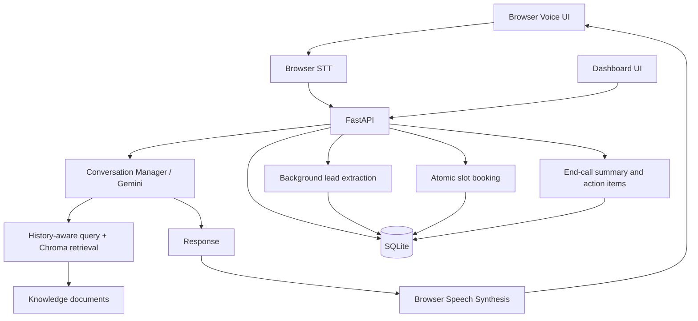

# Architecture and Design

## MVP architecture

## Request path
- `/chat`: returns the response; lead extraction is scheduled as a FastAPI background task.
- `/chat/stream`: streams response text; extraction starts after streaming completes.
- Retrieval query includes recent user turns for follow-ups; this MVP concatenates history instead of making another LLM rewrite call.
- Booking uses a conditional update (`booked_by IS NULL`) in an immediate transaction and a unique slot constraint. Competing booking attempts receive HTTP 409.
- End-call summarization stores summary, action items, final score, sentiment, and transcript.

## Production upgrades
Persist sessions in Redis, move background extraction and summarization to a durable queue, use PostgreSQL, add authentication and tenant isolation, use an actual streaming audio transport, validate tool permissions, apply rate limits, add observability, and enforce audio/transcript retention.
